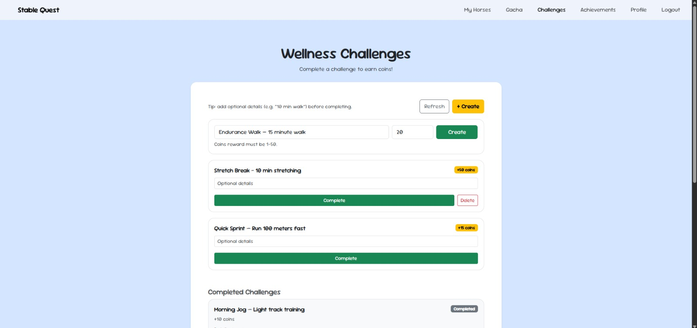
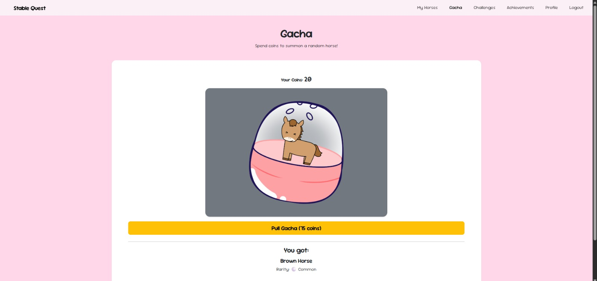
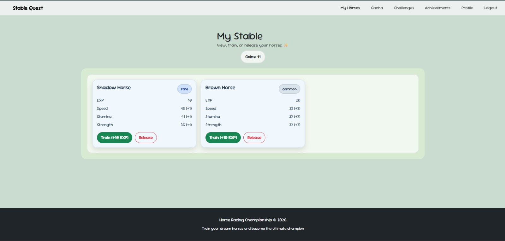
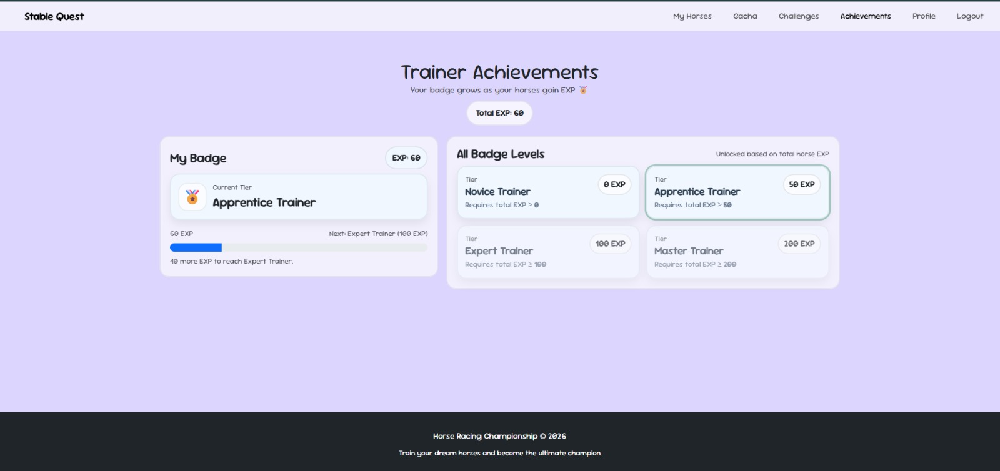

# 🐎 Stable Quest

A gamified wellness web app. Users complete wellness challenges to earn coins, then spend them to collect and train horses and unlock achievement badges.

Built as a full-stack school project for the Back-End Development module at Singapore Polytechnic (Jan – Feb 2026).


## Screenshots

| Wellness Challenges | Gacha Shop |
|---|---|
|  |  |
| **My Stable** | **Trainer Achievements** |
|  |  |
## Features

- **Accounts:** register and log in, with hashed passwords (bcrypt) and token-based login (JWT)
- **Wellness challenges:** complete challenges to earn coins, or create your own challenge with a coin reward (within set limits)
- **Gacha shop:** spend 75 coins to draw a random horse, with rarer horses having lower drop rates
- **Horse training:** spend 3 coins per session to raise a horse's stats and your lifetime EXP
- **Achievement badges:** unlocked as lifetime EXP grows

## Tech Stack

| Part | Tools |
|---|---|
| Front end | HTML, CSS, JavaScript, Bootstrap 5 |
| Back end | Node.js, Express |
| Database | MySQL |
| Security | bcrypt (password hashing), JWT (login tokens) |

## How It Works

The front end pages (in `public/`) call a REST API built with Express. The back end is split into layers:

- **Routes** decide which function handles each URL (e.g. a login request goes to the user controller)
- **Controllers** handle the request and check the input
- **Models** run the SQL queries against MySQL

### Progression design

Badges are based on the user's **lifetime EXP**, not on the horses they currently own. Every training session adds EXP to both the horse and the user, so:

- badges never go backwards
- progress reflects total effort, not current inventory

## Database

| Table | Stores |
|---|---|
| `User` | login details, coins and lifetime EXP |
| `WellnessChallenge` | available challenges and their coin rewards |
| `UserCompletion` | which user completed which challenge |
| `Horse` | horse catalogue: rarity and base stats |
| `UserHorse` | horses each user owns, and each horse's EXP |
| `TrainerBadge` | badge tiers and the EXP needed for each |

## Running It Locally

You need [Node.js](https://nodejs.org) and MySQL installed.

1. Clone the repo and install packages:
   ```bash
   git clone https://github.com/marcadrian08/stable-quest.git
   cd stable-quest
   npm install
   ```
2. Create a `.env` file in the main folder:
   ```
   DB_HOST=localhost
   DB_USER=your_mysql_user
   DB_PASSWORD=your_mysql_password
   DB_NAME=your_database_name
   JWT_SECRET=any_long_random_text
   ```
3. Set up the database tables:
   ```bash
   npm run init_tables
   ```
4. Start the server:
   ```bash
   npm run dev
   ```
5. Open http://localhost:3000 in your browser.

## Project Structure

```
stable-quest/
├── graphics/          images used on the pages
├── public/            front end
│   ├── css/           page styles
│   ├── js/            page scripts that call the API
│   └── *.html         pages: home, login, register, challenges, shop, my horses, badges, profile
├── src/               back end
│   ├── configs/       database schema and table setup
│   ├── controllers/   request handling
│   ├── middlewares/   bcrypt hashing and JWT checks
│   ├── models/        SQL queries
│   ├── routes/        API endpoints
│   ├── services/      MySQL connection
│   └── app.js         Express app setup
├── index.js           starts the server
└── package.json
```

## Image Credits

- `badge.jpg`, `challenge.jpg`, `horseHero.jpg`, `myHorses.jpg`, `register.jpg`: photos from [Unsplash](https://unsplash.com)
  - [badge](https://unsplash.com/photos/yellow-and-white-star-illustration-ZdqSuxl3Lak) · [challenge](https://unsplash.com/photos/a-man-running-across-a-field-on-a-sunny-day-UFs5bKHgo4U) · [horseHero](https://unsplash.com/photos/man-riding-horse-in-race-IojCPQ2rWe8) · [myHorses](https://unsplash.com/photos/girl-in-blue-jacket-holding-brown-horse-9ABBDJRVQ80) · [register](https://unsplash.com/photos/man-in-white-shirt-riding-brown-horse-during-daytime-vr7-UdiKQMU)
- `gacha.png` and `gachaPull.png`: designed by me
